# 地下管网平台（智慧管网平台）

面向城市地下管网运行管理的可视化交互原型，覆盖管网运行监控、压力/环境监测、告警处置、漏损预警与后台运维配置等场景。项目为纯静态前端，无需构建，数据和图表均为演示用途。

## 快速开始

直接用浏览器打开 `index.html` 即可。若需通过本地服务访问：

```bash
python -m http.server 8080
# 然后访问 http://localhost:8080
```

## 功能模块

| 模块 | 说明 |
| --- | --- |
| 综合驾驶舱 | 关键指标概览、告警数量趋势、地图叠加实时监测、告警站点排行、实时告警记录 |
| 管线运行监控 | 管网拓扑与测点运行状态 |
| 压力工况监视 | 各测点实时压力曲线与工况明细 |
| 环境参数感知 | 环境类传感数据汇总与趋势 |
| 告警处置中心 | 告警筛选、列表、详情抽屉与处置流程 |
| 噪声异响分析 | 噪声波形与异响识别结果 |
| 安全运行报告 | 安全指标汇总与报告预览、导出 |
| 漏损预警 | 漏损疑似清单与漏点定位详情 |
| 台账信息维护 | 设备台账、设备详情与远程管理入口 |
| 压力特性分析 / 流量趋势分析 / 水锤工况分析 | 后台专项分析视图 |
| 告警策略设置 | 告警规则配置 |
| 组织机构维护 | 组织架构与人员管理 |

## 截图

| 综合驾驶舱 | 管线运行监控 |
| --- | --- |
| 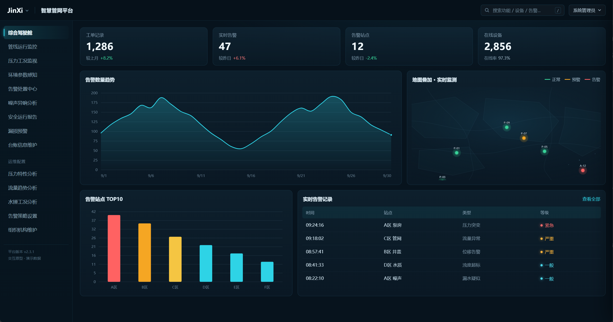 | 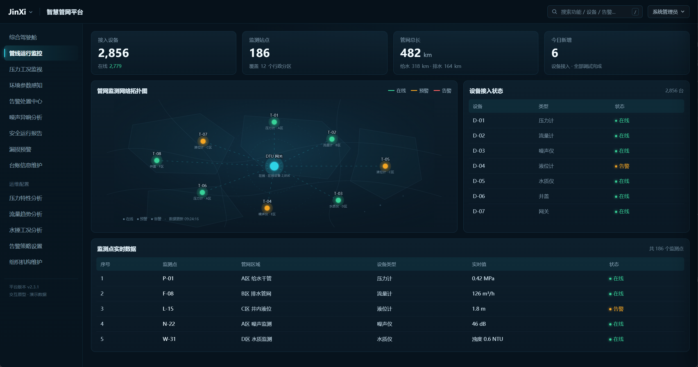 |

| 压力工况监视 | 环境参数感知 |
| --- | --- |
| 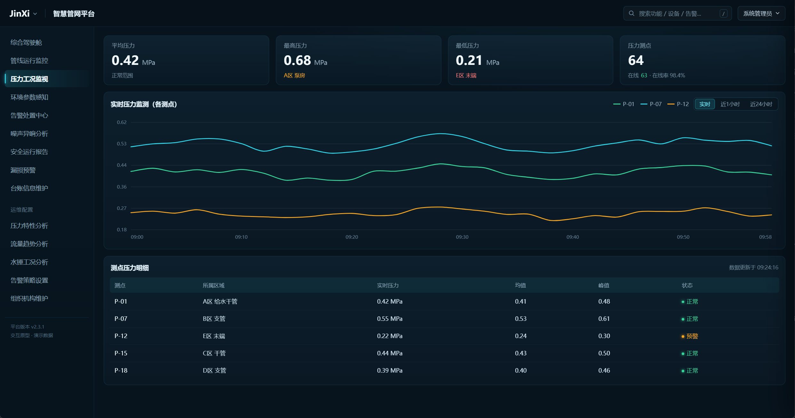 | 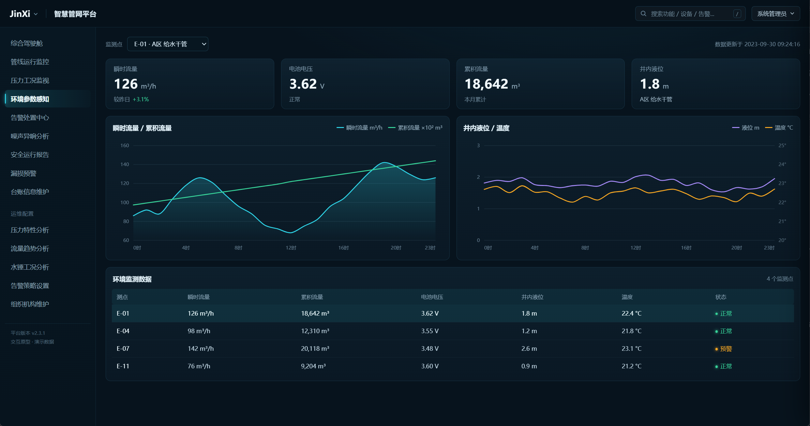 |

| 告警处置中心 | 噪声异响分析 |
| --- | --- |
| 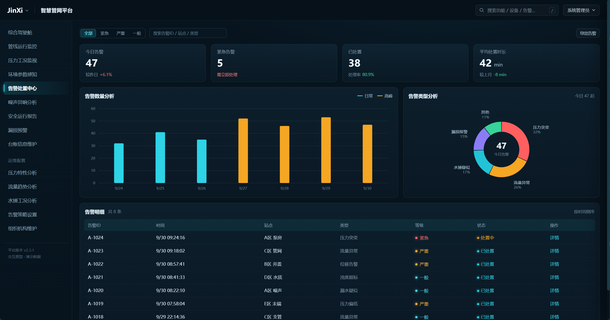 | 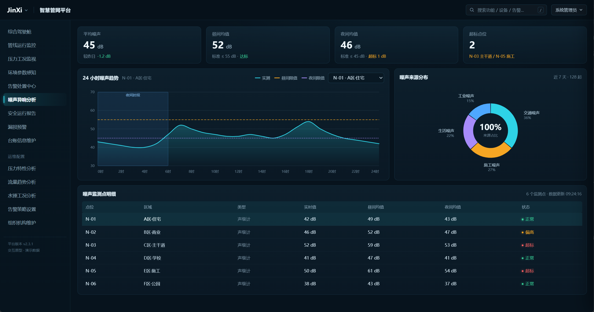 |

| 安全运行报告 | 漏损预警 |
| --- | --- |
| 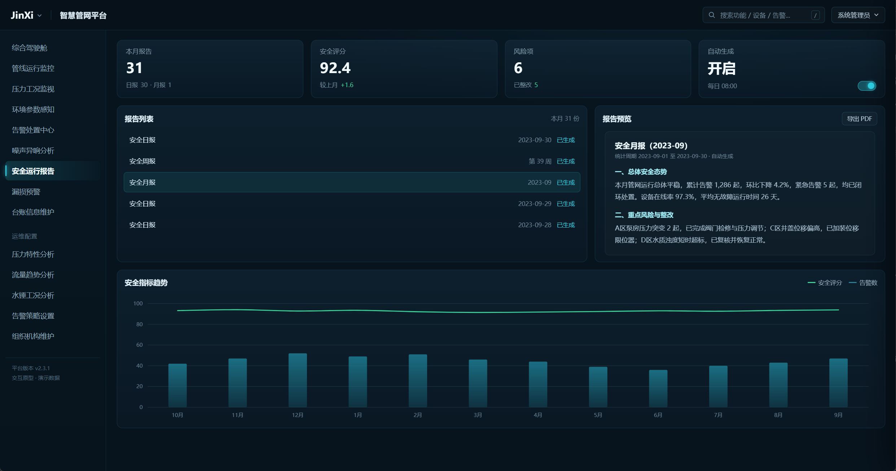 | 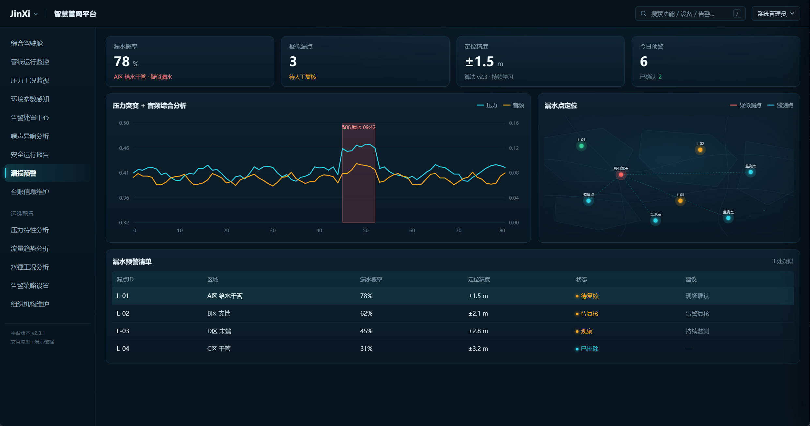 |

| 台账信息维护 | 压力特性分析 |
| --- | --- |
| 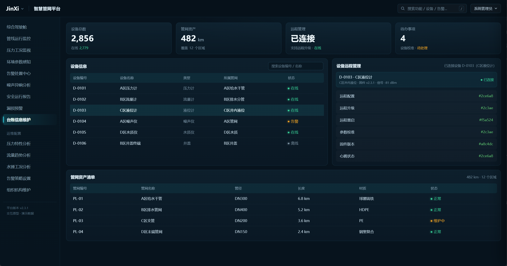 | 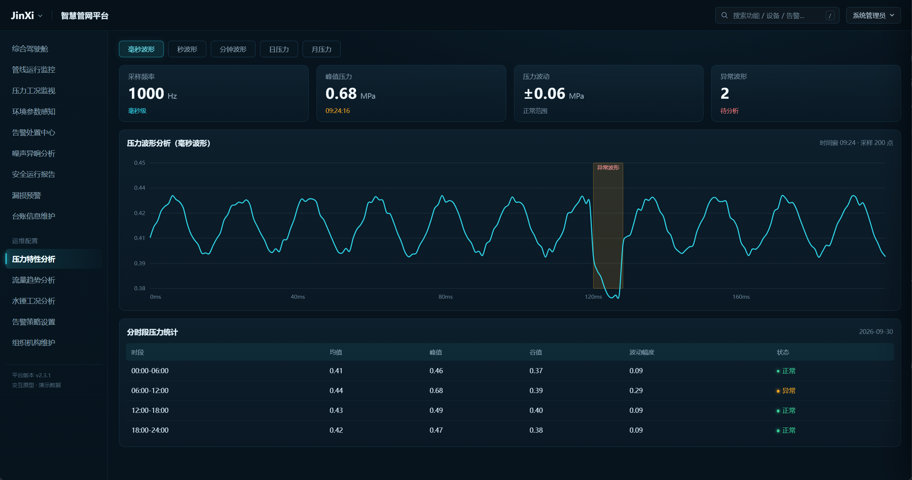 |

| 流量趋势分析 | 水锤工况分析 |
| --- | --- |
| 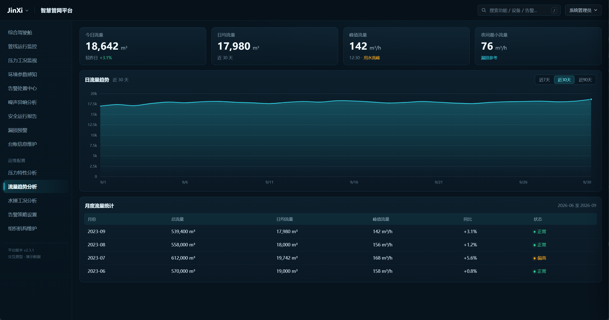 | 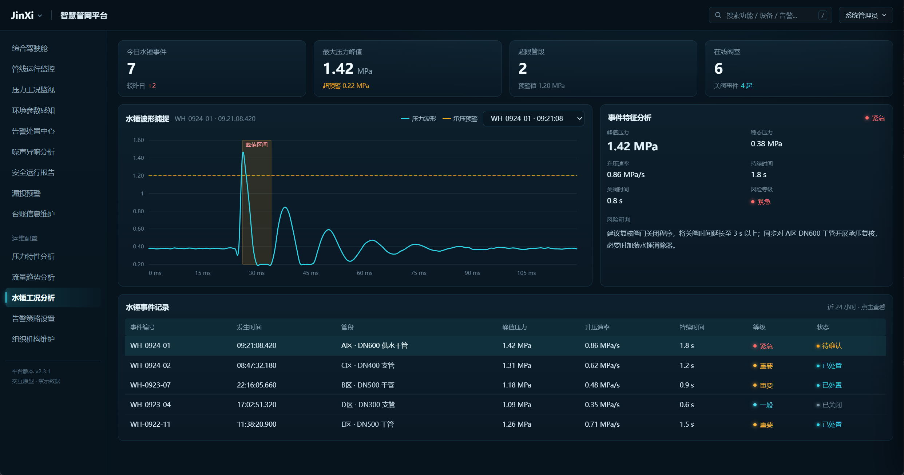 |

| 告警策略设置 | 组织机构维护 |
| --- | --- |
| 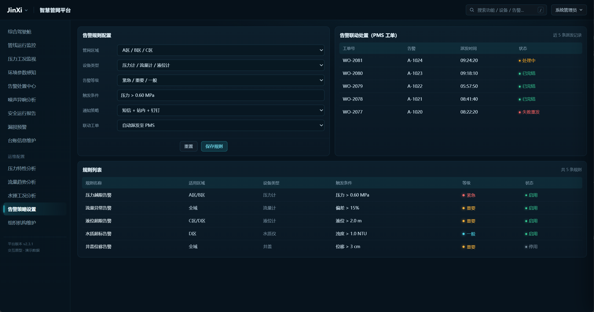 | 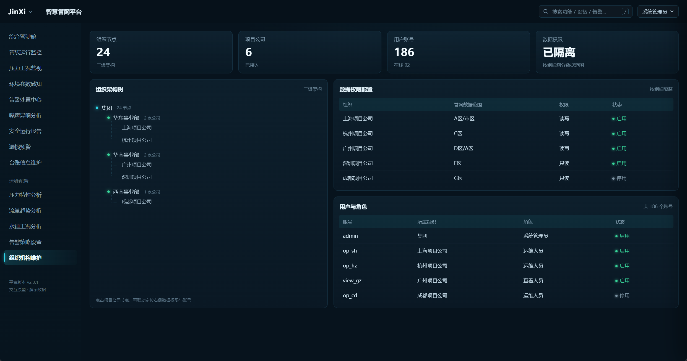 |
